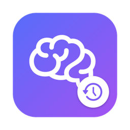
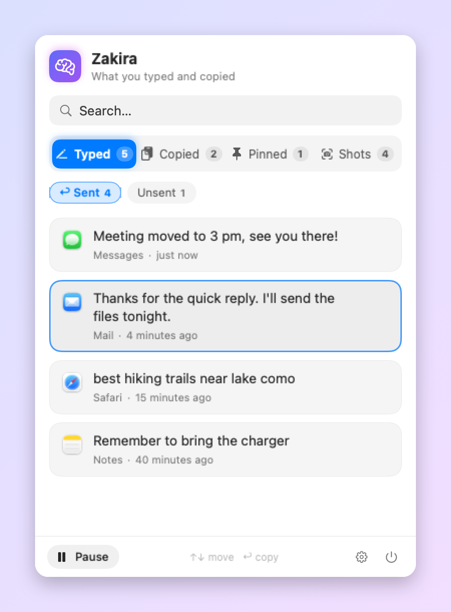
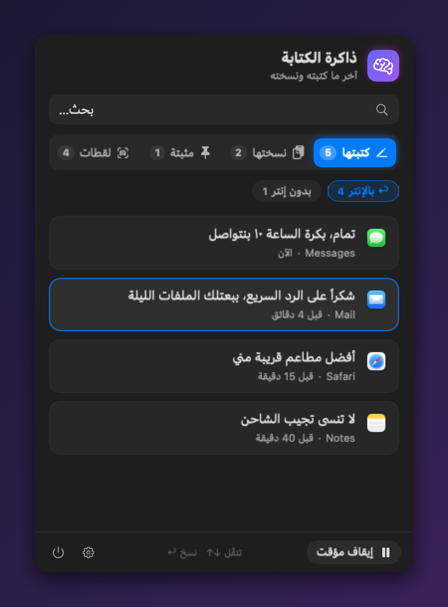
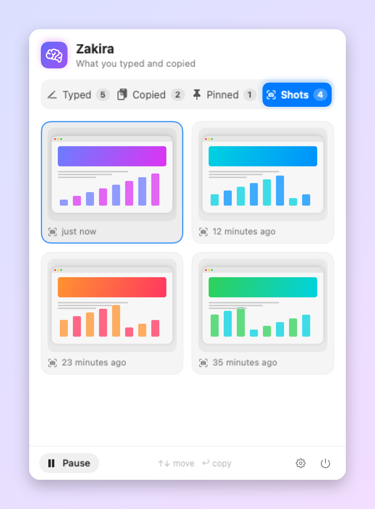
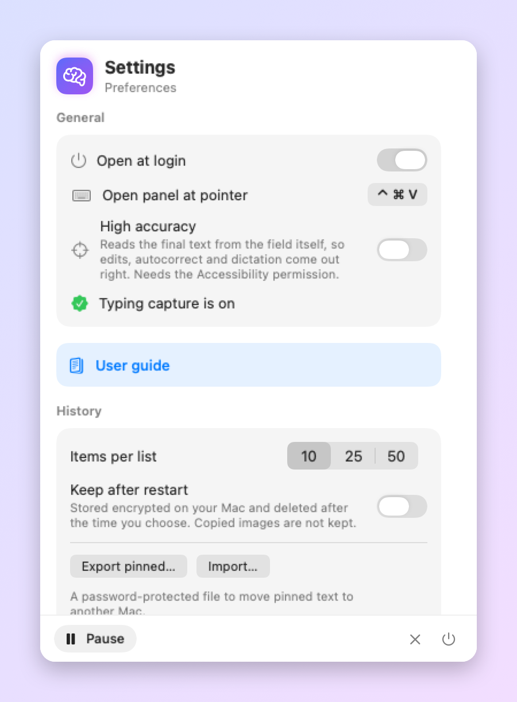
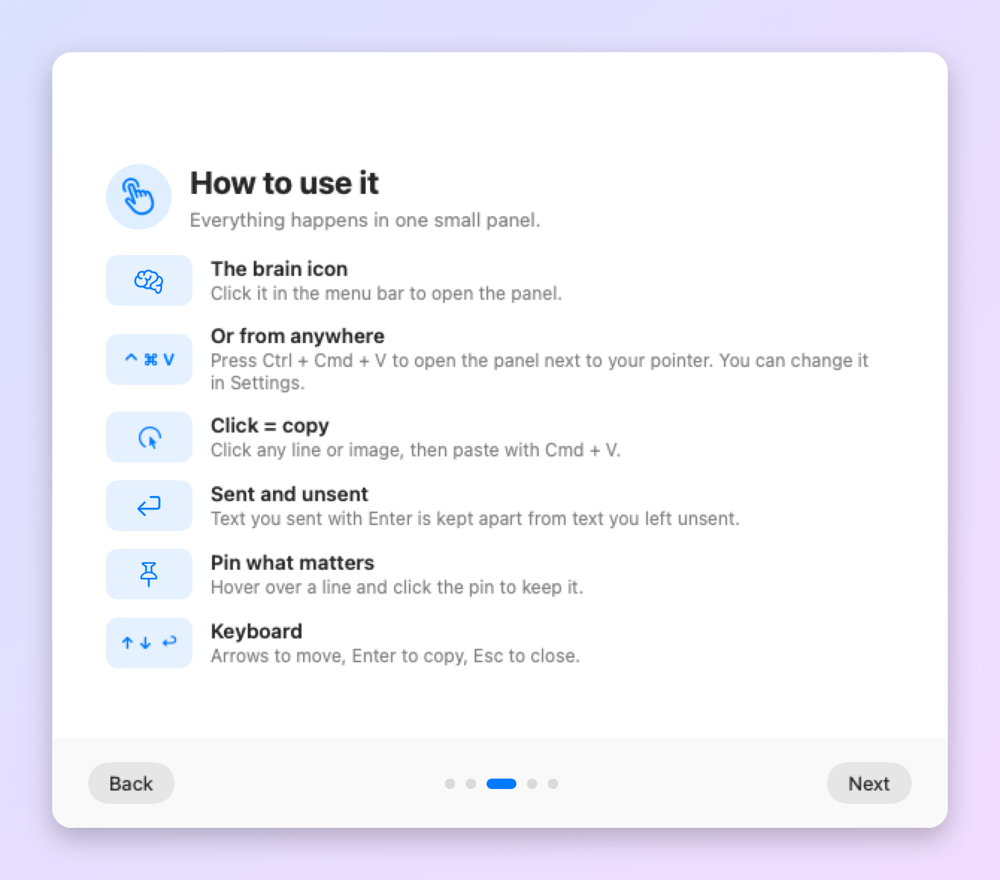
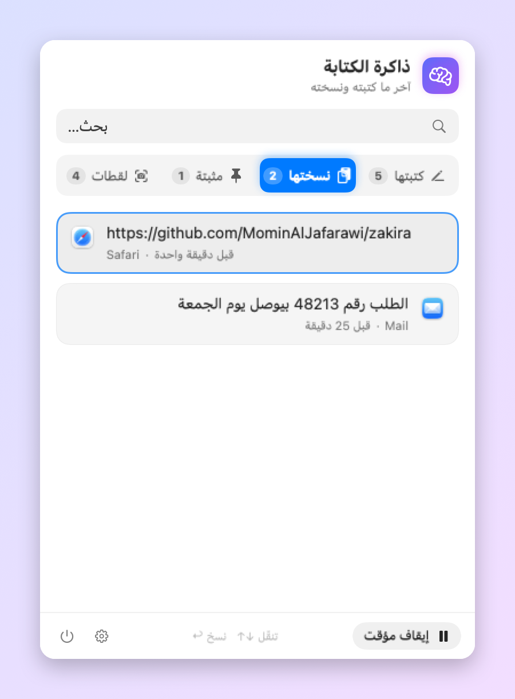
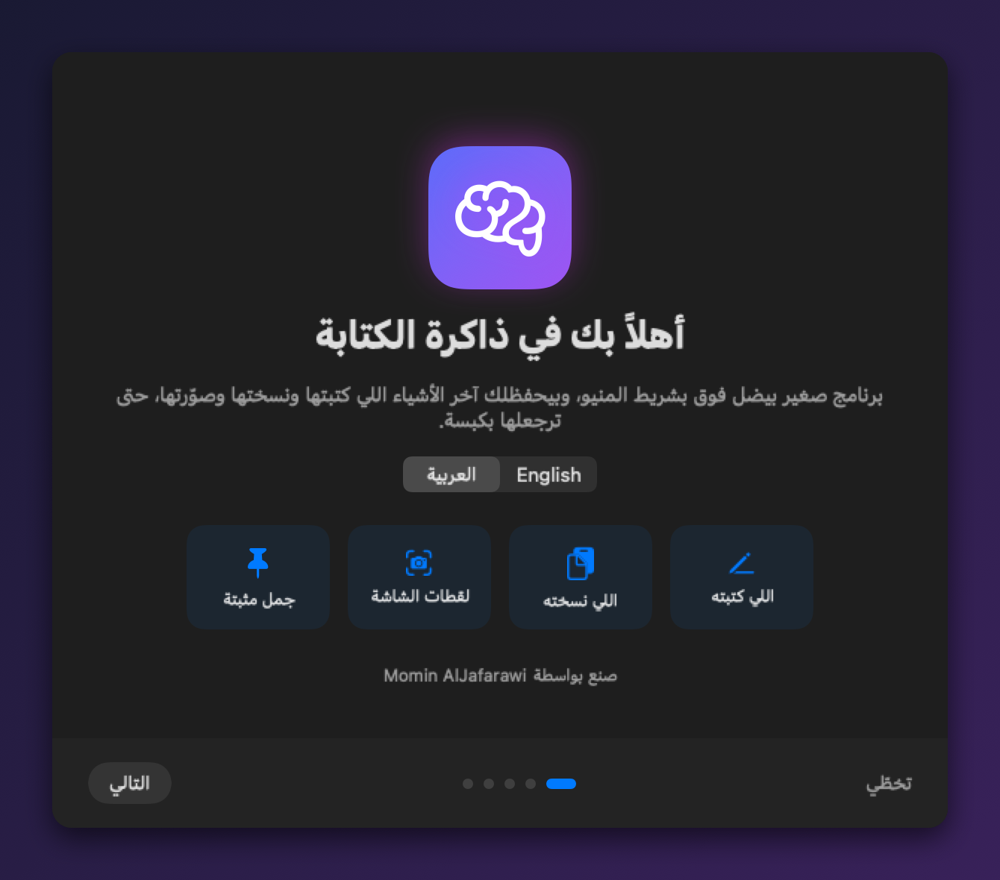

<div align="center">



# Zakira · ذاكرة الكتابة

**Your Mac's short-term memory.** The last things you typed, copied and captured, one click away.

**ذاكرة قصيرة لجهازك:** آخر شي كتبته ونسخته وصوّرته، بكبسة وحدة.

[](https://github.com/MominAlJafarawi/zakira/actions/workflows/build.yml)

[**⬇️ Download for macOS**](https://github.com/MominAlJafarawi/zakira/releases/latest) · macOS 14+ · Apple Silicon & Intel · English / العربية · Free & open source

[English](#english) · [العربية](#العربية)

 

</div>

---

## English

Ever closed a window and lost the message you just wrote? Copied something new and lost what was on the clipboard? Zakira lives in your menu bar and quietly keeps the last few things for you.

### Features

- ✍️ **Typed text**, split into **Sent** (you pressed Enter) and **Unsent** (you clicked away or stopped). It follows the cursor, so edits in the middle of a sentence come out right, and it understands dead keys (é, ê, ü).
- 🎯 **High accuracy** (optional): reads the final text straight from the field, so autocorrect and dictation are right too.
- 📝 **Long-form apps**: in Notes, Word, Pages, code editors and more, Enter is a new line, not a send. You can edit the list.
- 📋 **Copied text and images**: the last items you copied.
- 📸 **Screenshots** from every method (Cmd+Shift+3/4/5 and the clipboard-only Ctrl+Cmd+Shift+3/4), shown the moment you take them. Click to copy, or drag into any app.
- 📌 **Pinned** text that never disappears, with password-protected **export/import** to move it to another Mac.
- ⌨️ **Ctrl + Cmd + V** opens the panel next to your pointer. You can change the shortcut.
- 🔢 Keep **10, 25 or 50** items per list, and optionally keep history after a restart (encrypted, 1 day or 1 week).
- 🌐 Arabic and English (right-to-left for Arabic), light and dark mode, full keyboard navigation, VoiceOver and Reduce Motion support.

 

### Install

1. Download `Zakira-x.y.dmg` from [Releases](https://github.com/MominAlJafarawi/zakira/releases/latest).
2. *(Optional)* Check the file is untouched. Open Terminal in your Downloads folder and run the command below. The result must match the `.sha256` file published next to the DMG.
   ```bash
   shasum -a 256 Zakira-*.dmg
   ```
3. Open the DMG and drag **Zakira** onto **Applications**.
4. Open Zakira from Applications. macOS will block it the first time, because Zakira is not signed with a paid Apple Developer ID:
   - Click **Done** (not "Move to Trash").
   - Open ** → System Settings → Privacy & Security**.
   - Scroll down to the message about Zakira and click **Open Anyway**, then confirm with your password or Touch ID.
   - This is needed **once**.
5. A short guide opens. Turn on **Input Monitoring** for Zakira. Without it, copies and screenshots still work, but typed text is not saved.

Prefer not to trust a downloaded app? [Build it yourself](#build-from-source) from this code in two commands.



### Privacy

Zakira was built to keep your data on your Mac.

| | |
|---|---|
| 🌐 **No internet** | The app never connects anywhere. The only exception is the **optional** weekly update check (off by default), which asks GitHub for the latest version number and sends nothing about you. |
| 💳 **Secrets are never saved** | Card numbers (Luhn-checked), one-time codes and password-like text are dropped. IBANs are saved masked (`DE89 •••• •••• •••• 3000`). macOS blocks password fields too. |
| 🧠 **Memory first** | Typed and copied text lives in memory and is gone when you quit, unless you turn on *Keep after restart*. |
| 🔐 **Encrypted on disk** | Pinned text, the optional saved history and clipboard screenshots are encrypted with keys kept in your macOS Keychain. |
| 🚫 **Excluded apps** | Passwords, Keychain Access, 1Password, Bitwarden and all Terminal apps (sudo prompts don't hide your password) are excluded by default. Add any app, such as your bank. |
| 🖥️ **Hidden from screen sharing** | The panel is marked to stay out of screen sharing and recordings. Some recording tools on newer macOS may ignore this, so close the panel before sharing to be safe. |
| 📄 **Private log** | The diagnostic log only has technical events. Activity details are logged only in *Diagnostic mode*, which turns itself off after 24 hours. It never contains your text. |
| ⏸️ **Pause** | Stop recording at any time. |

### ⚠️ Responsible use

Zakira records keystrokes on the Mac it runs on. Use it **only on your own Mac**. Installing it on someone else's computer to watch what they type is unethical and illegal in most countries.

### Build from source

Requires the Xcode Command Line Tools (`xcode-select --install`). No Xcode project needed.

```bash
./test.sh                   # runs the self-tests
./build.sh                  # builds a universal app and installs it to /Applications
./make-dmg.sh               # builds dist/Zakira-<version>.dmg and its SHA-256
Tools/make-screenshots.sh   # re-renders the README screenshots with demo text
```

If a code-signing identity named `Zakira Code Signing` exists in your Keychain, the build uses it. Otherwise it falls back to an ad-hoc signature. Every push is built and tested by [GitHub Actions](https://github.com/MominAlJafarawi/zakira/actions). Want to help test? See the [tester checklist](docs/TESTING.md).

---

## العربية

<div dir="rtl">

صار معك إنك سكّرت نافذة وراحت الرسالة اللي كتبتها؟ أو نسخت شي جديد وضاع اللي كان منسوخ قبله؟ **ذاكرة الكتابة** برنامج صغير بيضل فوق بشريط المنيو، وبيحفظلك آخر الأشياء بهدوء.

### الميزات

- ✍️ **اللي كتبته**، مقسوم لقسمين: **بالإنتر** (بعتّه) و**بدون إنتر** (تركته أو ضغطت بمكان تاني). بيتبع المؤشر، فالتعديل بنص الجملة بيطلع صح، وبيفهم الأحرف المركّبة (é، ê، ü).
- 🎯 **دقة عالية** (اختيارية): بيقرأ النص النهائي من الخانة نفسها، فالتصحيح التلقائي والإملاء الصوتي بيطلعوا صح.
- 📝 **برامج الكتابة الطويلة**: بالـ Notes و Word و Pages وبرامج الكود، Enter سطر جديد مش إرسال. والقائمة بتقدر تعدّلها.
- 📋 **النصوص والصور اللي نسختها.**
- 📸 **لقطات الشاشة** بكل الطرق (Cmd+Shift+3/4/5 واللقطات للحافظة Ctrl+Cmd+Shift+3/4)، بتظهر بنفس اللحظة. كبسة بتنسخها، أو بتسحبها لأي برنامج.
- 📌 **جمل مثبتة** ما بتنمحي، مع **تصدير واستيراد** بكلمة سر لتنقلها لماك تاني.
- ⌨️ **Ctrl + Cmd + V** بيفتح اللوحة جنب الماوس، وبتقدر تغيّر الاختصار.
- 🔢 **10 أو 25 أو 50** عنصر بكل قائمة، وحفظ اختياري بعد إعادة التشغيل (مشفّر، ليوم أو أسبوع).
- 🌐 عربي وإنجليزي، ووضع فاتح وداكن، وتنقّل كامل بالكيبورد، ودعم VoiceOver و"تقليل الحركة".

 

### التثبيت

1. نزّل ملف `Zakira-x.y.dmg` من [Releases](https://github.com/MominAlJafarawi/zakira/releases/latest).
2. *(اختياري)* تأكد إن الملف ما انعدّل: افتح Terminal بمجلد التنزيلات واكتب `shasum -a 256 Zakira-*.dmg`. النتيجة لازم تطابق ملف `.sha256` اللي جنب الـ DMG.
3. افتح الـ DMG واسحب **Zakira** على **Applications**.
4. افتح Zakira. أول مرة ماك رح يمنعه، لأنه مش موقّع بحساب مطوّر مدفوع من Apple:
   - اضغط **Done** (مش "Move to Trash").
   - افتح ** ← الإعدادات ← Privacy & Security**.
   - انزل لتحت للرسالة عن Zakira واضغط **Open Anyway**، وأكّد بكلمة السر أو البصمة.
   - هالخطوة **مرة وحدة بس**.
5. بيفتحلك دليل قصير. فعّل إذن **Input Monitoring**. بدونه، النسخ واللقطات بيشتغلوا، بس الكتابة ما بتنحفظ.

ما بتحب تثق ببرنامج منزّل؟ [ابنيه بنفسك](#build-from-source) من الكود بأمرين.

### الخصوصية

- 🌐 **ما في إنترنت:** البرنامج ما بيتصل بأي مكان. الاستثناء الوحيد هو التحقق الأسبوعي من التحديثات، وهو **اختياري ومطفي**، وبيسأل GitHub عن رقم آخر نسخة بس.
- 💳 **الأسرار ما بتنحفظ أبداً:** أرقام البطاقات، وأكواد التحقق، والنصوص اللي بتشبه الباسوردات. والـ IBAN بينحفظ مخفي.
- 🧠 **بالذاكرة أولاً:** الكتابة والنسخ بينمحوا لما تسكّر البرنامج، إلا إذا شغّلت *احفظ بعد إعادة التشغيل*.
- 🔐 **كل شي على الجهاز مشفّر:** الجمل المثبتة، والسجل المحفوظ، ولقطات الحافظة، بمفاتيح بالـ Keychain تبعك.
- 🚫 **برامج مستثناة:** برامج الباسوردات وكل برامج الـ Terminal بشكل افتراضي، وبتقدر تضيف أي برنامج متل البنك.
- 🖥️ **مخفية بمشاركة الشاشة:** اللوحة معلّمة إنها ما تظهر بمشاركة الشاشة والتسجيل. بعض برامج التسجيل الجديدة ممكن تتجاهل هالشي، فالأأمن تسكّر اللوحة قبل المشاركة.
- 📄 **سجل خاص:** سجل التشخيص فيه أشياء تقنية بس، وما فيه أبداً شي من كتابتك.

### ⚠️ الاستعمال المسؤول

البرنامج بيسجّل الكتابة على الجهاز اللي بيشتغل عليه. استعمله **على جهازك الشخصي بس**. تثبيته على جهاز حدا تاني لمراقبة كتابته مش أخلاقي، وممنوع قانونياً بأغلب الدول.

بدك تساعد بالتجربة؟ شوف [قائمة التجربة](docs/TESTING.md).

</div>

---

## License

[MIT](LICENSE) © 2026 [Momin AlJafarawi](https://github.com/MominAlJafarawi)
